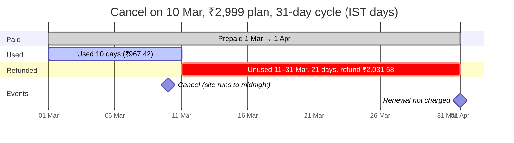

# Billing and proration

<p className="lede">Monthly in advance, accounted per day in IST, refunded by whole unused days. Rounding always favours the customer by less than one paisa.</p>

## The policy in five lines

1. Plans are priced per cycle but accounted per **IST calendar day** (Asia/Kolkata, UTC+05:30, no DST). A day runs 00:00 to 24:00 IST.
2. A cycle is the real number of days between renewal dates: 28 to 31 for a month.
3. Any day that has started counts in full, including today.
4. **Cancel:** the site stays active to 24:00 IST today. Unused whole days are refunded pro rata to the original payment method.
5. **Plan change:** the new plan applies from the **start of the next IST day**; the remaining days are re-priced.

## Rounding

Refunds and credits round **down** (`prorate_down`, a floor). Charges round **up** (`prorate_up`, a ceiling). Everything is integer minor units.

```text
refund = floor(paid × days_unused ÷ cycle_days)
charge = ceil(price × days_remaining ÷ cycle_days)
```

## Billing timeline

<Diagram title="Billing timeline for the cancel example" caption="Cancel on 10 March, a 2,999 rupee plan, a 31-day cycle, counted in IST days." description="The customer prepaid the cycle from 1 March to 1 April, 31 days. Days 1 to 10 March are used and kept, 967.42 rupees. Days 11 to 31 March, 21 days, are unused and refunded, 2,031.58 rupees. The cancel milestone is on 10 March and the site runs until 24:00 that day. The renewal on 1 April is not charged.">



</Diagram>

<div className="formula">refund = floor(299900 × 21 ÷ 31) = 203158 paise</div>

## Worked examples

All numbers below were computed by running the real functions in `saas_core/billing/proration.py` (`cancel_quote`, `change_quote`); the script is `scripts/verify-billing-examples.py` in the docs repo.

<Tabs items={['Cancel', 'Upgrade', 'Downgrade']}>
  <Tabs.Tab>

Plan ₹2,999.00 per month (299900 paise). Cycle 1 March to 1 April is 31 days. The customer cancels on 10 March, at any time that day in IST.

- Days used: 10 (1 to 10 March, today in full). Days unused: 21.
- Refund = floor(299900 × 21 ÷ 31) = **203158 paise = ₹2,031.58**.
- Charge kept = ₹967.42.
- The site stops at 11 March 00:00 IST (10 March 18:30 UTC).

<Badge status="verified" /> Preview any of these with `billing.preview_cancel` / `billing.preview_change` before acting.

  </Tabs.Tab>
  <Tabs.Tab>

₹999 (99900) to ₹2,999 (299900) on 10 March, same 31-day cycle, the customer holds 99900. The new plan applies from 11 March, so 21 days remain.

- Old share = floor(99900 × 21 ÷ 31) = 67674.
- New share = ceil(299900 × 21 ÷ 31) = 203159.
- Due now = **135485 paise = ₹1,354.85**, paid by payment link.

<Badge status="verified" /> Preview any of these with `billing.preview_cancel` / `billing.preview_change` before acting.

  </Tabs.Tab>
  <Tabs.Tab>

₹2,999 (299900) to ₹999 (99900) on 10 March, the customer holds 299900. 21 days remain.

- Old share = floor(299900 × 21 ÷ 31) = 203158.
- New share = ceil(99900 × 21 ÷ 31) = 67675.
- Credit refunded = **135483 paise = ₹1,354.83**.

<Badge status="experimental" /> The downgrade path is labelled experimental in STATUS.md. Preview any of these with `billing.preview_cancel` / `billing.preview_change` before acting.

  </Tabs.Tab>
</Tabs>

## Edge cases

### Cancelling on the last day

Zero unused days, so the refund is 0 (verified: cancelling on 31 March in the example above refunds 0).

### Change on the last day

The effective date is the renewal date (1 April) and zero days remain, so there is nothing to re-price.

### Discounts and earlier proration

The old share comes from what the customer actually holds for the cycle, not from the list price, so discounts and earlier prorations stay consistent. The direction (upgrade or downgrade) is decided by list price.

### Gateway without refunds

Stripe is <Badge status="experimental" /> and has no refunds, so cancel-with-refund fails with a clear error and the refund is flagged `refund_failed`.

## API

Preview first, then act. Success responses are wrapped as `{"message": ...}`. Mutations need the CSRF token from `me.csrf_token`.

```bash
API=https://control.example.com/api/method/saas_core.api.v1

curl -b jar.txt "$API.billing.preview_cancel?tenant=acme"
curl -b jar.txt -X POST "$API.billing.cancel" -H 'Content-Type: application/json' \
  -H 'X-Frappe-CSRF-Token: <csrf_token>' -H 'Idempotency-Key: cancel-1' -d '{"tenant":"acme"}'
```

`billing.preview_change` and `tenants.change_plan` follow the same pattern; check the request fields in [openapi/v1.yaml](https://github.com/tridz-open/saas_core/blob/main/openapi/v1.yaml).

## Renewals and dunning

Renewals are monthly in advance. Automated renewal paths and staged dunning (days 1, 3, 7 and 14 after the first failure, stage 3 suspends) are <Badge status="experimental" /> and off by default; see [Status](/status/).

## Taxes and invoices

> [!IMPORTANT]
> saas_core issues **receipts only**. There are no tax invoices without ERPNext.

Sources: [saas_core/billing/proration.py](https://github.com/tridz-open/saas_core/blob/main/saas_core/billing/proration.py), [README: Billing policy](https://github.com/tridz-open/saas_core#billing-policy), [STATUS.md](https://github.com/tridz-open/saas_core/blob/main/docs/STATUS.md).

<AlphaFooter repo="saas_core" />
