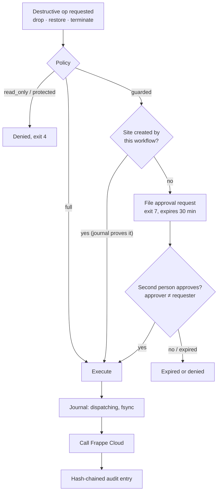

# Approvals

Destructive operations never run on one person's say-so. Both saas_core and fcctl put an approval gate in front of them.

## Two gates, two layers

| Layer | How it works |
|---|---|
| saas_core Approval Request | Two-person: the approver must differ from the requester and hold the role SaaS Admin. Required for `terminate` and `restore` jobs. Statuses: `pending`, `approved`, `executing`, `executed`, `failed`, `expired`, `outcome_unknown`. Carries a `digest` and `blast_radius`. |
| fcctl approvals | Gated operations under the `guarded` policy file a request and exit 7. Requests expire after 30 minutes. Approvals can be Ed25519-signed. Without pinned keys it is a speed bump, not separation of duties. |

## The flow

<Diagram title="Approval gate flow" caption="The fcctl guard. saas_core adds its own two-person gate before it re-runs the operation." description="A destructive operation such as drop, restore or terminate is checked against the policy. read_only and protected deny it with exit 4; full executes it. Under guarded, an operation on a site created by the same workflow, proven by the journal, executes. Anything else files an approval request, exit 7, expiring in 30 minutes. A second person different from the requester approves it, otherwise it expires or is denied. Execution is journalled with fsync first, then calls Frappe Cloud and writes a hash-chained audit entry.">

</Diagram>

## Workflow ownership

Library calls on a site that the same workflow created pass `owned_by_workflow=<id>` and are exempt, but only if the journal proves it. Anything else returns a `PendingApproval`, so a service needs its own approval step, which is what saas_core's Approval Request is.

See [Security](/security/) for the whole model.

Sources: [saas_core ARCHITECTURE.md](https://github.com/tridz-open/saas_core/blob/main/ARCHITECTURE.md), [docs/ARCHITECTURE.md §4](https://github.com/tridz-open/saas_core/blob/main/docs/ARCHITECTURE.md), [fcctl README: Safety model](https://github.com/tridz-open/fcctl#safety-model).

<AlphaFooter repo="saas_core" />
