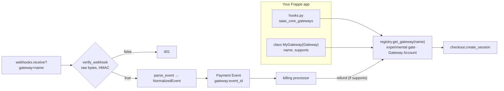

# Payment gateways

saas_core takes payments through a pluggable Gateway class. Billing never imports a provider.

## Gateway status

| Gateway | Status | Notes |
|---|---|---|
| `razorpay` | <Badge status="verified" /> test mode | `order` checkout is the verified path. Subscription mode is <Badge status="experimental" /> |
| `stripe` | <Badge status="experimental" /> | Needs `saas_core_experimental=stripe`. Built from docs, never run live. No refunds |
| `manual` | Mock | Test mode only; never usable in live mode |
| `fake` | Reference implementation | Needs `fake_gateway`; `all` does not enable it |
| your plugin | Whatever you declare | See [Adding a gateway](/guides/adding-a-gateway/) |

## How a gateway plugs in

<Diagram title="Gateway plugin flow" caption="A plugin registers in hooks.py; checkout and webhooks both resolve it through the registry." description="Your app defines a Gateway subclass and registers it through the saas_core_gateways hook. The registry resolves it by name, applies the experimental gate and loads the Gateway Account. Checkout uses the registry to create a session. Incoming webhooks hit the generic receive endpoint, which verifies the signature over the raw bytes; false gives 401. A valid body is parsed into a NormalizedEvent, stored as a Payment Event keyed gateway:event_id and passed to the billing processor, which may call back into the registry for refunds.">

</Diagram>

## Capabilities

Declare a capability if and only if you implement it.

| Capability | If missing |
|---|---|
| `subscription` | You can still do `order` |
| `order` | Declare at least one of `subscription` or `order` |
| `portal` | `return_url` is used |
| `client_callback` | Callback endpoint answers 422; confirm by webhook only |
| `refund` | Refund fails, non-retryable; subscription flagged `refund_failed` |
| `refund_lookup` | A retry of a possibly sent refund is refused |
| `payment_lookup` | Over-refund check skipped |
| `plan_update` | Local schedule stands; provider plan unchanged |
| `invoice_lookup` | Cancel flags `refund_payment_unknown` |
| `payment_link` | Renewal invoice cannot be issued |

## Money rules

1. Integer minor units everywhere, never floats.
2. Every amount travels with a currency, taken from the chosen Plan Price row. Never defaulted.
3. A refund is in the payment's currency.
4. Amounts come from server-side Plan Price rows, never from the browser.
5. Convert zero- and three-decimal currencies inside your adapter.

## Webhook security

1. Verify the signature over the exact raw bytes before parsing JSON, with a constant-time compare.
2. Return `False`, do not raise, for bad or missing signatures; the layer answers 401.
3. Reject stale signed timestamps when the provider signs one.
4. Header names are case-insensitive.
5. Only the first insert of a `<gateway>:<event_id>` Payment Event enqueues processing.
6. Unknown gateways get a generic `400 Invalid webhook request`.
7. URLs: `/api/method/saas_core.webhooks.razorpay`, or generic `/api/method/saas_core.webhooks.receive?gateway=<name>`.

## Policy

saas_core does not ship new real gateways. Add yours in your own app through the `saas_core_gateways` hook.

Sources: [gateways README](https://github.com/tridz-open/saas_core/blob/main/docs/gateways/README.md), [CONTRACT.md](https://github.com/tridz-open/saas_core/blob/main/docs/gateways/CONTRACT.md).

<AlphaFooter repo="saas_core" />
