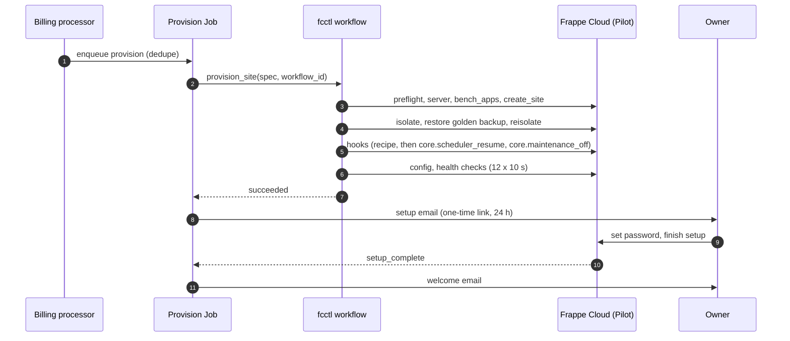

# Provisioning

Provisioning turns a paid tenant into a running Frappe site, through an auditable, resume-safe job.

## Pay, then provision

<Diagram height={560} title="Provisioning sequence" caption="From a paid event to a welcome email." description="The billing processor enqueues a provision job, de-duplicated. The job calls the fcctl workflow, which runs preflight, server, bench apps and create site on Frappe Cloud, then isolates the site, restores the golden backup and re-isolates. It runs the hooks, config and health checks (12 attempts, 10 seconds apart). On success the job emails the owner a one-time setup link. After the owner finishes setup, the site reports setup_complete and the job sends the welcome email.">

</Diagram>

## Provision Job

Kinds: `provision`, `suspend`, `resume`, `change_plan`, `terminate`, `backup`, `restore`. States: `pending`, `dispatching`, `submitted`, `running`, `succeeded`, `failed`, `stuck`, `outcome_unknown`, `needs_attention`. Runner failures normally land in `needs_attention`, with the Tenant set to `failed`.

### Resume safety

Before dispatching, the runner asks the port `find_workflow(workflow_id)`. A finished workflow is adopted, a failed one fails the job, a running one is resumed by id.

### Reconcile

`reconcile.run` runs every 15 minutes. `terminate`, `backup` and `restore` jobs with an unknown outcome go to `needs_attention` and are never auto-retried.

## The ten fcctl steps

<Steps>

### preflight

### server

### bench_apps

### create_site

### isolate

### restore

### reisolate

### hooks

### config

### health

</Steps>

> [!NOTE]
> A failure in steps 1 to 4 leaves the workflow running; re-run with `--workflow-id` and finished steps are skipped. A failure in steps 5 to 10 sets `needs_attention`. See the [upstream diagram](https://github.com/tridz-open/fcctl/blob/main/docs/assets/provision-site-steps.svg).

## Health checks

Pilot's own site health runs first. Then each `{name, path, expect}` is requested over HTTPS, 12 attempts 10 seconds apart by default (`saas_core_fc_health_attempts`, `saas_core_fc_health_delay`).

## Two-step onboarding email

The first mail carries a one-time set-password link (default expiry 24 hours, `saas_core_setup_link_expiry_hours`). The welcome mail is sent only after the tenant site reports setup complete. The admin password is never mailed and the setup URL is never stored or logged.

Sources: [docs/ARCHITECTURE.md §4, §6](https://github.com/tridz-open/saas_core/blob/main/docs/ARCHITECTURE.md), [docs/TEMPLATES.md](https://github.com/tridz-open/saas_core/blob/main/docs/TEMPLATES.md), [fcctl steps diagram](https://github.com/tridz-open/fcctl/blob/main/docs/assets/provision-site-steps.svg).

<AlphaFooter repo="saas_core" />
