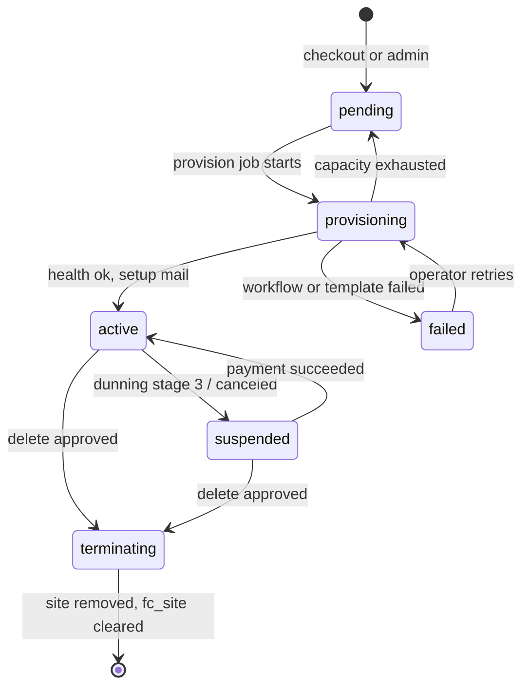

# Tenants

A tenant is one customer's isolated Frappe site, tracked by a Tenant record on the control plane.

## The Tenant record

| Field | Meaning |
|---|---|
| `slug` | The Tenant's name (autoname) |
| `owner_user` | The user who owns it; permissions follow this field |
| `status` | `pending`, `provisioning`, `active`, `suspended`, `terminating`, `failed` |
| `plan`, `template` | What the customer bought and what the site is built from |
| `fc_site` | The real Frappe Cloud host name |
| `custom_domain` | Optional customer domain |
| `active_job` | The Provision Job currently running |
| `recipe_fields` | JSON of extra signup fields your recipe asked for |

## States

<Diagram height={720} title="Tenant states" caption="Statuses of a Tenant. There is no terminated status." description="A tenant starts pending, from checkout or an admin. A provision job moves it to provisioning, then active once health checks pass and the setup mail is sent. A workflow or template failure makes it failed, and an operator retry returns it to provisioning. Capacity exhaustion returns it to pending. An active tenant becomes suspended on dunning stage 3 or cancellation and returns to active on a successful payment. Active or suspended tenants become terminating when deletion is approved, and the tenant ends when the site is removed and fc_site is cleared.">

</Diagram>

### There is no "terminated"

After a successful terminate job the tenant stays `terminating` with `fc_site` cleared.

### Suspension

Dunning stage 3 or a `subscription.canceled` event enqueues a `suspend` job. A later successful payment enqueues `resume`. Dunning is <Badge status="experimental" />, as are suspend, resume and terminate jobs.

## Site names and domains

`saas_core_site_domain` is optional. Unset, tenant sites use the first wildcard domain Frappe Cloud gives; the real host is stored in `fc_site`.

## Limits per user

`saas_core_max_tenants_per_user` and `saas_core_capacity_open` in site_config cap how many tenants a user may create and whether new ones are accepted.

Sources: [saas_core ARCHITECTURE.md](https://github.com/tridz-open/saas_core/blob/main/ARCHITECTURE.md), [docs/ARCHITECTURE.md §5](https://github.com/tridz-open/saas_core/blob/main/docs/ARCHITECTURE.md), [DEPLOY.md](https://github.com/tridz-open/saas_core/blob/main/DEPLOY.md), [docs/STATUS.md](https://github.com/tridz-open/saas_core/blob/main/docs/STATUS.md).

<AlphaFooter repo="saas_core" />
