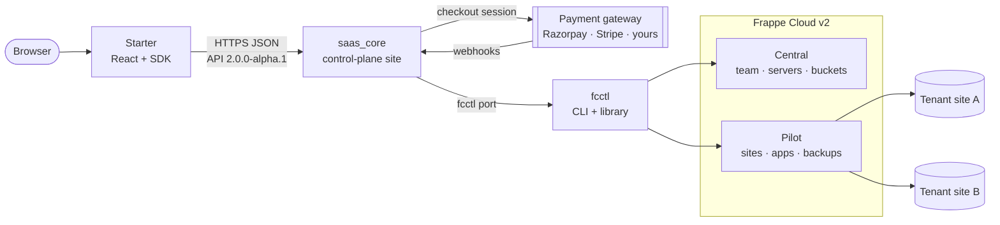

<Hero eyebrow="Alpha · v0.1.0" eyebrowLink={{label: 'Read the status', href: '/status/'}} title="Sell your Frappe app as SaaS." sub="Customers sign up, pay, and get their own Frappe site on Frappe Cloud, built automatically from your golden backup. Billing, provisioning and a customer console, open source." primary={{label: 'Get started', href: '/getting-started/'}} secondary={{label: 'Run the local demo', href: '/guides/local-demo/', icon: 'Terminal'}} note="browser → starter → saas_core → fcctl → Frappe Cloud">
<Screenshot name="landing" alt="Frappe SaaS starter landing page for a Frappe app sold as SaaS" frame="browser" priority />
<Screenshot name="provisioning-in-progress" alt="Provisioning progress with per-step status" frame="browser" overlay />
</Hero>

<Section title="From signup to a running site" sub="Five steps, each one auditable and safe to retry.">
<Flow steps={[
  {icon:'UserPlus', title:'Sign up', body:'Your starter app collects the account. Signup can be open, invite-only or allowlisted.'},
  {icon:'CreditCard', title:'Pay', body:'Checkout runs through a pluggable gateway. Each payment is recorded exactly once.'},
  {icon:'Server', title:'Provision', body:'saas_core starts a job; fcctl restores your golden backup into a new Frappe Cloud site.'},
  {icon:'MailCheck', title:'Hand over', body:'Health checks pass, then the owner gets a one-time setup link.'},
  {icon:'RefreshCw', title:'Renew or cancel', body:'Monthly in advance. Cancel any day; unused whole days are refunded.'}
]} />
</Section>

<Section tone="subtle" title="Everything between &quot;Buy&quot; and a live site">
<FeatureGrid cols={3}>
  <Feature icon="Layers" title="Golden-backup provisioning">Every tenant is restored from a prepared site, then your hooks run and health checks confirm it is up.</Feature>
  <Feature icon="Wallet" title="Fair, day-based billing">Monthly in advance, accounted per IST day. Refunds round down, charges round up, always in whole minor units.</Feature>
  <Feature icon="Plug" title="Pluggable gateways">Razorpay is verified. Stripe is experimental. Add your own gateway from your own app.</Feature>
  <Feature icon="ShieldCheck" title="Approval gates">Dropping a site or restoring a backup waits for a second person. Every action lands in a hash-chained audit log.</Feature>
  <Feature icon="RotateCcw" title="Resume-safe jobs">Provisioning is journalled step by step. A crash is reconciled, never blindly retried.</Feature>
  <Feature icon="LayoutDashboard" title="Customer console">A React starter with pricing, checkout, instances, billing and backups. Fork it and brand it.</Feature>
  <Feature icon="Puzzle" title="Recipes">Plug your app in with a template and optional Python hooks, provisioned per customer.</Feature>
  <Feature icon="FlaskConical" title="Mock everything">Fixture mode, a mock SDK, a fake fcctl and a fake Frappe Cloud: build without touching production.</Feature>
  <Feature icon="Bot" title="Agent-ready docs">llms.txt, raw Markdown for every page and a copy-paste setup prompt.</Feature>
</FeatureGrid>
</Section>

<Section title="How the pieces fit" sub="Frontends only talk to saas_core. Only the server talks to Frappe Cloud, only through fcctl.">

<Diagram title="Frappe SaaS architecture" caption="Payment gateways call back into saas_core webhooks. Frappe Cloud v2 is split into Central (team, servers) and Pilot (sites, backups)." description="A browser talks to the starter, which calls the saas_core control-plane site over HTTPS JSON. saas_core creates checkout sessions with a payment gateway and receives its webhooks. saas_core reaches Frappe Cloud v2 only through fcctl, which talks to Central (team, servers, buckets) and Pilot (sites, apps, backups). Pilot hosts the tenant sites.">



</Diagram>

[Read the architecture →](/architecture/)

</Section>

<Section tone="subtle" title="Three repos, one kit">
<Repos />
</Section>

<Section title="What your customers see" sub="Captured from the starter in fixture mode, no backend.">
<Gallery cols={3} items={[
  {name:'pricing', alt:'Pricing page with three plans and a highlighted popular tier'},
  {name:'signup', alt:'Signup form'},
  {name:'checkout', alt:'Checkout order summary before the payment provider'},
  {name:'provisioning-in-progress', alt:'Provisioning progress with per-step status'},
  {name:'console-instances', alt:'Customer console listing instances with status and URL'},
  {name:'console-billing', alt:'Billing page with subscription and invoices'}
]} />
</Section>

<Section tone="subtle">
<Logos />
</Section>

<Section title="Built for coding agents too">
<div className="split">
<div>

Point your agent at one file. Every page is also plain Markdown, and the setup prompt keeps it on test keys and fake infrastructure.

- `/llms.txt`
- `/<page>.md`
- "Copy page" on every page

[Open the agent guide →](/agents/)

</div>
<div>

```text
Read https://frappesaas.tridz.in/llms.txt, then follow
https://frappesaas.tridz.in/agents.md to set up a local demo.
Use test keys only and never touch a real Frappe Cloud team.
```

</div>
</div>
</Section>

<Section tone="subtle">

> [!WARNING]
> **Alpha software. Use at your own risk.** All three repos are early alpha. Expect breaking changes with no migration path. Pin exact tags, use test-mode payment keys only, and try everything on throwaway sites first. We are not accepting pull requests; please file issues. See [Versions](/status/versions/) and [Status](/status/).

</Section>

<Section tone="center" title="Ship your Frappe app as a product." sub="Start with the starter in fixture mode. It takes two commands.">

`npm install && npm run dev`

<div className="hero-cta">
  <a className="btn btn--primary" href="/getting-started/">Get started</a>
  <a className="btn btn--secondary" href="https://github.com/tridz-open/frappe-saaskit" rel="noopener">View on GitHub</a>
</div>

<AlphaFooter repo="saas_core" />

</Section>
