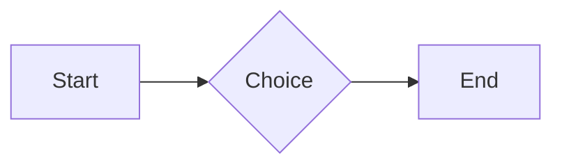

# Kitchen sink

<p className="lede">A lede paragraph sets up the page in one sentence, in muted lede type.</p>

## Callouts

> [!NOTE]
> A note with `inline code` and a [link](/architecture/).

> [!TIP]
> A tip.

> [!IMPORTANT]
> Important: receipts only.

> [!WARNING]
> Warning: test keys only.

> [!CAUTION]
> Caution: `fcctl site config set` puts values on argv.

<Callout type="warning" title="A titled JSX callout">Body text inside a JSX callout.</Callout>

## Badges

<Badge status="verified" /> <Badge status="experimental" /> <Badge status="tested" /> <Badge status="untested" /> <Badge status="alpha">Alpha · v0.1.0</Badge> <Badge status="removed" /> <Badge status="stub" /> <Badge status="released" />

## Cards

<Cards num={3}>
  <Cards.Card title="Look at the UI" href="/getting-started/" icon={<Icon name="MonitorSmartphone" />}>Run the starter in fixture mode.</Cards.Card>
  <Cards.Card title="Run it locally" href="/architecture/" icon={<Icon name="Laptop" />}>The whole flow, fake fcctl.</Cards.Card>
  <Cards.Card title="Take payments" href="/payments/" icon={<Icon name="CreditCard" />}>Razorpay test mode.</Cards.Card>
</Cards>

## Feature grid

<FeatureGrid cols={3}>
  <Feature icon="Layers" title="Golden-backup provisioning">Every tenant is restored from a prepared site.</Feature>
  <Feature icon="Wallet" title="Fair, day-based billing">Accounted per IST day.</Feature>
  <Feature icon="Plug" title="Pluggable gateways">Razorpay is verified.</Feature>
</FeatureGrid>

## Repo cards

<Repos />

## Steps

<Steps>

### Clone the starter

```bash
git clone https://github.com/tridz-open/frappe-saaskit-starter.git
```

### Run it

Open `http://localhost:5173`.

</Steps>

## Tabs

<Tabs items={['Razorpay', 'Stripe']}>
  <Tabs.Tab>

Razorpay <Badge status="verified" /> body.

```bash
echo razorpay
```

  </Tabs.Tab>
  <Tabs.Tab>

Stripe <Badge status="experimental" /> body.

  </Tabs.Tab>
</Tabs>

## File tree

<FileTree>
  <FileTree.Folder name="saas-kit-demo" defaultOpen>
    <FileTree.Folder name="saas_core" />
    <FileTree.File name="notes.txt" />
  </FileTree.Folder>
</FileTree>

## Screenshot and gallery

<Screenshot name="pricing" alt="Pricing page" caption="A browser-framed screenshot." frame="browser" />

<Gallery cols={3} items={[
  {name:'pricing', alt:'Pricing page with three plans'},
  {name:'signup', alt:'Signup form'},
  {name:'checkout', alt:'Checkout summary'}
]} />

## Diagram

<Diagram title="Tiny flow" caption="A tiny flow." description="A goes to B, and B goes to C.">



</Diagram>

## Version table

<VersionTable data="versions" />

<VersionTable data="status" />

## FAQ details

<details>
<summary>Is this production ready?</summary>

No. It is alpha.

</details>

<Logos />

<AlphaFooter />
