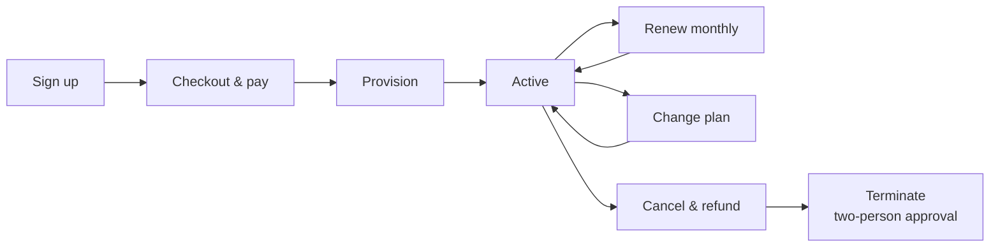

# Customer lifecycle

Sign up, pay, get a site, keep paying, leave with a fair refund. Here is what happens at each step.

<Diagram title="Customer lifecycle" caption="Verified stages: sign up, checkout, provision, active, upgrade, cancel. Experimental: automated renewal, downgrade, terminate." description="A customer signs up, checks out and pays, and is provisioned, then becomes active. From active the customer can renew monthly or change plan, both returning to active, or cancel and receive a refund. A cancelled tenant can later be terminated, which needs two-person approval.">

</Diagram>

| Stage | Status |
|---|---|
| Sign up, checkout, provision, active, upgrade, cancel and refund | <Badge status="verified" /> |
| Automated renewal and dunning, downgrade, terminate | <Badge status="experimental" /> |

<Steps>

### 1. Sign up <Badge status="verified" />

The signup gate is `closed` (default), `invite`, `allowlist` or `open`. An allowlist also requires a verified email at checkout. The public config reports `signup_mode` so a front end can hide the form.

<Screenshot name="signup" alt="Signup form" caption="Signup, in the starter." />

### 2. Checkout and pay <Badge status="verified" />

`checkout.create_session` is called with an `Idempotency-Key`. A pending Tenant is created, and the amount comes only from the server-side Plan Price. Verified for Razorpay `order` mode.

<Screenshot name="checkout" alt="Checkout order summary before the payment provider" caption="Checkout summary." />

### 3. Provision <Badge status="verified" />

The payment event is processed, a `provision` job runs through fcctl, and the owner gets a setup email. See [Provisioning](/concepts/provisioning/).

<Screenshot name="provisioning-in-progress" alt="Provisioning progress with per-step status" caption="Provisioning progress." />

### 4. Active <Badge status="verified" />

The customer uses the console. Daily tenant backups are verified; the offsite copy is experimental.

<Screenshot name="console-instances" alt="Customer console listing instances with status and URL" caption="The customer console." />

### 5. Renew <Badge status="experimental" />

Billing is monthly in advance. Automated renewals and dunning are experimental (see [Subscriptions](/concepts/subscriptions/)). Dunning stages fall at 1, 3, 7 and 14 days after the first failure; stage 3 suspends.

### 6. Change plan

Upgrade is <Badge status="verified" />: a payment link for the difference, and the new plan from the next IST day. Downgrade is <Badge status="experimental" />.

### 7. Cancel and refund <Badge status="verified" />

The site stays active to the end of the current IST day and unused whole days are refunded pro rata to the original method. See the [worked examples](/billing/#worked-examples).

### 8. Terminate <Badge status="experimental" />

Requires a two-person approval. See [Approvals](/concepts/approvals/).

</Steps>

## Who does what

| Stage | Starter / SDK | saas_core | fcctl | Frappe Cloud |
|---|---|---|---|---|
| Sign up | signup form, `auth.signup` | signup gate, user | none | none |
| Checkout | `checkout.createSession` | pending Tenant, Payment Event | none | none |
| Provision | `subscribe` to job progress | Provision Job, emails | `provision_site` workflow | creates and restores the site |
| Active | console, backups | daily backups | `backup create` | hosts the site |
| Cancel | `billing.previewCancel`, `cancel` | refund calculation, refund | none | site suspended |
| Terminate | request delete | Approval Request, job | guarded drop | drops the site |

Sources: [docs/ARCHITECTURE.md §3 to §7](https://github.com/tridz-open/saas_core/blob/main/docs/ARCHITECTURE.md), [DEPLOY.md: Beta access](https://github.com/tridz-open/saas_core/blob/main/DEPLOY.md), [STATUS.md](https://github.com/tridz-open/saas_core/blob/main/docs/STATUS.md).

<AlphaFooter repo="saas_core" />
